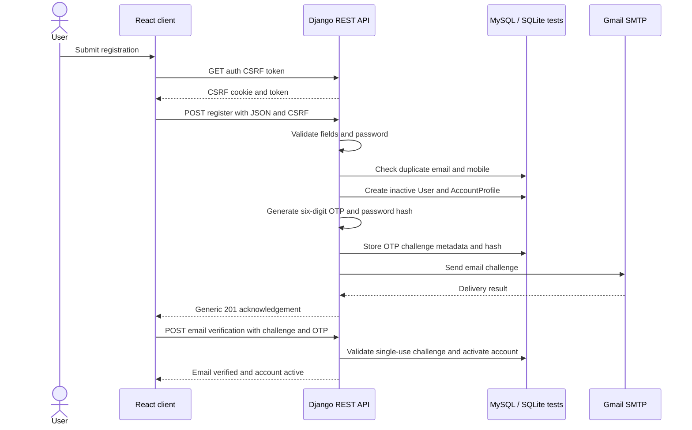
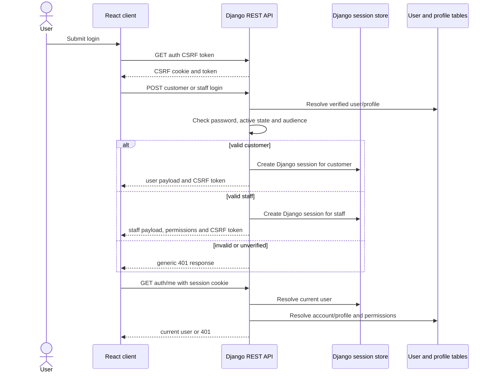

# Authentication and Session Security

## Scope

SPICEORA uses Django's built-in user model, Django session authentication, CSRF protection, and a customer `AccountProfile`. Staff users are separate through Django `is_staff` and model permissions. SMS verification is not implemented; mobile verification returns a deferred response.

## Account lifecycle

### Registration

1. The client first obtains a CSRF token from `GET /api/v1/auth/csrf/`.
2. `POST /api/v1/auth/register/` accepts `full_name`, `email`, `mobile_number`, `password`, and `confirm_password`.
3. Django validates the email, E.164 mobile number, password, unknown fields, and duplicate/availability conditions.
4. A new Django user is created inactive and non-staff.
5. An `AccountProfile` stores the normalized email, E.164 mobile number, and verification flags.
6. An email OTP challenge is created with a cryptographically random code hashed through Django password hashing.
7. Registration returns an identical acknowledgement shape for new and duplicate submissions, subject to anti-enumeration timing controls.
8. The challenge remains usable for five minutes and allows five incorrect attempts.

### Email OTP verification

`POST /api/v1/auth/verify/email/` accepts a challenge UUID and six-digit code. Successful verification marks the profile email verified and activates the customer account. OTP codes are single-use, expire, and can be invalidated by resend. Password reset uses the same challenge infrastructure with the `password_reset` purpose.

### Mobile verification

`POST /api/v1/auth/verify/mobile/` returns `410 Gone`. Mobile numbers may be stored and validated as E.164, but SMS delivery and mobile login are not implemented.

### Login

Customer login uses `/api/v1/auth/login/`. It requires a registered email, active verified customer account, verified email, and matching password. Staff login uses `/api/v1/auth/operations/login/` and requires a matching `is_staff` user. Login creates a Django session and returns a current-session user payload plus a renewed CSRF token.

### Logout

`POST /api/v1/auth/logout/` requires the Django session and CSRF token, then calls Django logout. Logout invalidates the browser session but is not the same as separately testing server-side session expiration.

### Password recovery

1. `/api/v1/auth/recovery/start/` returns a generic response for known and unknown identities.
2. Email is currently the only recovery channel.
3. `/api/v1/auth/recovery/verify/` verifies the recovery OTP and returns a flow identifier.
4. `/api/v1/auth/recovery/reset/` validates matching passwords, verifies the challenge, changes the password, consumes the challenge, invalidates matching Django sessions, and logs out the current request.

## Registration sequence

Delivery failures return safe availability responses rather than returning OTP codes or credentials. The diagram describes the normal design, not a claim that every production delivery path has been verified.

## Login sequence

## Session and CSRF behavior

- Django session cookies are HTTP-only and `SameSite=Lax` by default in the current settings.
- The CSRF initialization endpoint returns a token and sets the CSRF cookie.
- The React client holds the token in memory and sends it as `X-CSRFToken` for unsafe requests.
- Passwords, OTPs, session IDs, and CSRF tokens are not persisted in localStorage.
- Production secure-cookie, HTTPS, exact CSRF origin, session-expiration, and cross-site settings require environment-specific verification.
- Logout destroys the current Django session.

## Permissions

### Customer

- May register, verify email, log in, recover an account, read the public `/me` identity state, and log out.
- May not use staff operations endpoints.
- Public catalogue and enquiry endpoints are available without customer authentication.

### Staff

- Must use an active Django user with `is_staff=true`.
- Each operations route requires independent Django model permissions.
- View-only, add-only, change-only, combined view/change, and customer-denial behavior is tested independently.
- Inventory correction movements require `api.approve_inventory_correction` in addition to the movement model permissions.
- Frontend route and button guards improve navigation but do not replace backend authorization.

## Failure handling

- Invalid credentials return a generic 401 response.
- CSRF failures are rejected by Django/DRF before protected operations execute.
- Anonymous operations requests receive the authentication challenge or permission denial defined by the view.
- OTP, recovery, resend, and verification failures remain designed around generic or field-level validation responses and do not return secrets or active codes.
- Actual provider delivery, distributed throttling, and production session expiration remain environment-dependent and must be verified separately.
