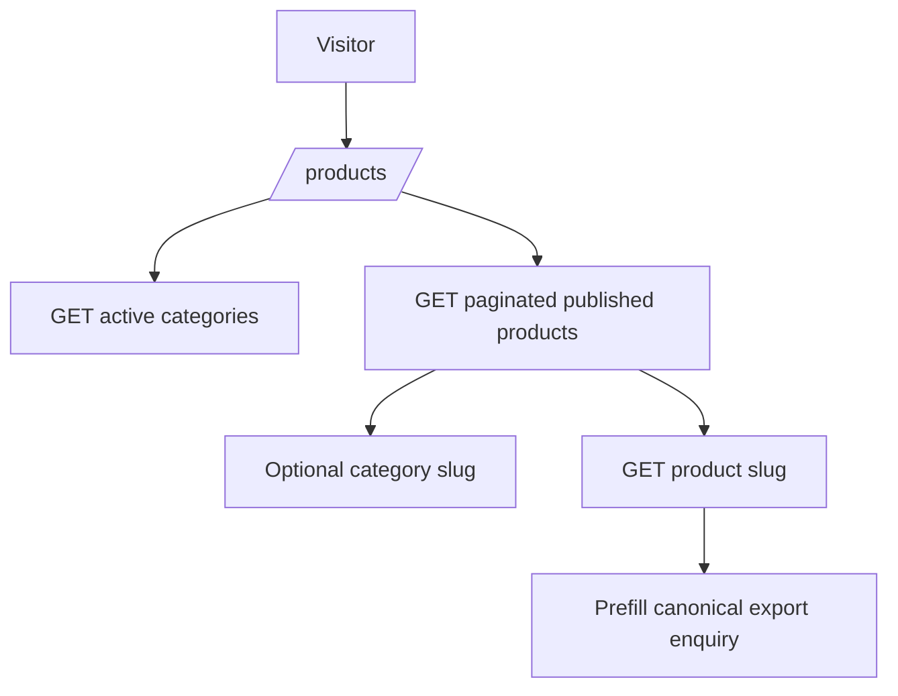
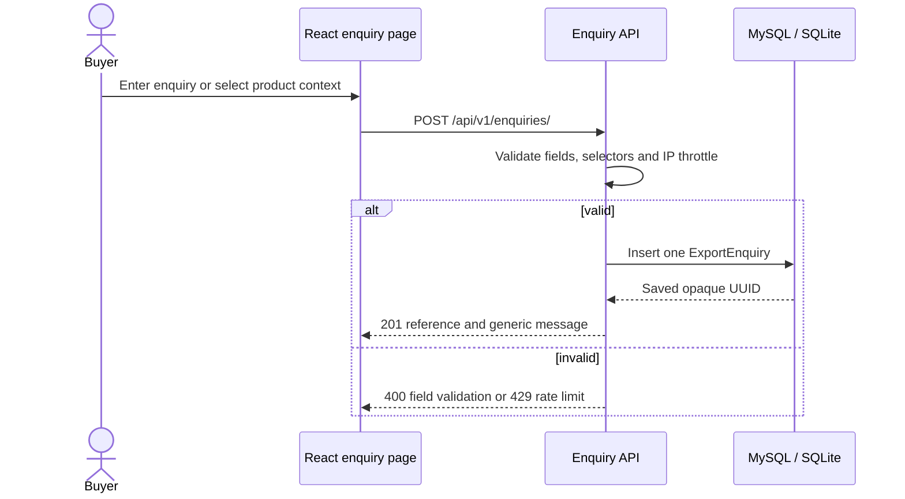
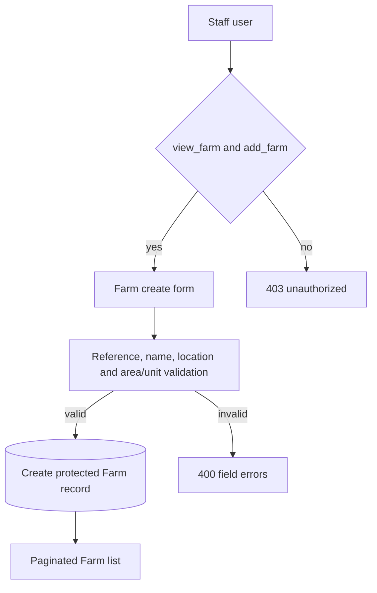
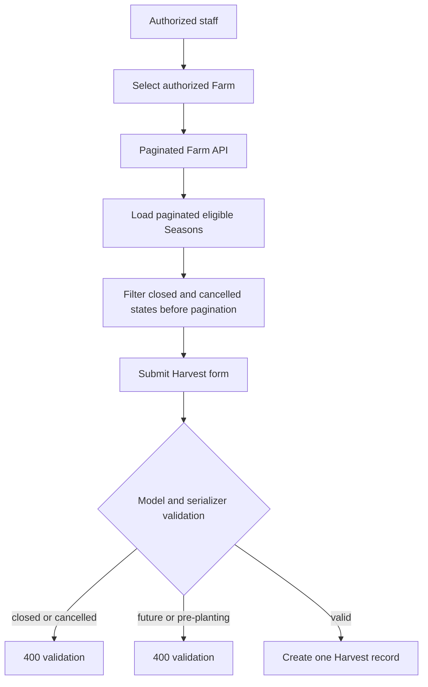
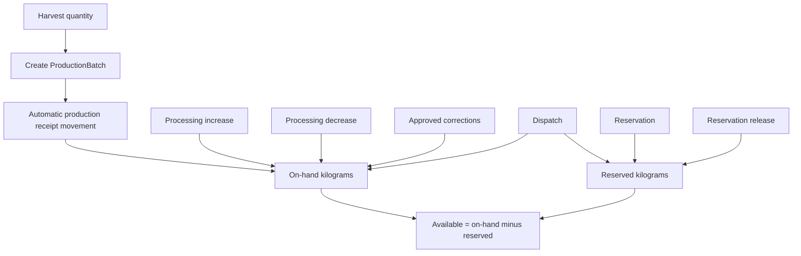

# Implemented Business Workflows

This document separates verified implementation from downstream model foundations and deferred interfaces. It does not describe an order, buyer, shipment, or inventory market workflow unless the repository implements it.

## 1. Product browsing

**Implemented.** Visitors browse active categories and published products through React routes and public read APIs. Product detail, missing-image behavior, category filtering, and pagination are implemented. Zero public product records are currently seeded.

## 2. Export enquiry submission

**Implemented.** Visitors submit exactly one category or published-product interest with server-validated contact, quantity, and unit fields. The public API returns an opaque UUID receipt and no list/read endpoint.

## 3. Staff enquiry management

**Implemented.** Staff users with `view_exportenquiry` and `change_exportenquiry` can use the protected enquiry inbox and detail view. The list minimizes personal-data exposure; the detail view returns contact and internal fields. Status and notes are the only supported PATCH fields. Enquiry deletion remains unavailable through the dashboard.

## 4. Farm creation

**Implemented.** Authorized staff can create a uniquely referenced active or inactive Farm with name, location, optional area/unit, description, and private notes. Identity/location/area edits become protected once Crop Seasons exist.

## 5. Crop Season creation

**Implemented.** Staff with `add_cropseason` create a uniquely referenced Season linked to an existing Farm. Dates are optional but a planting date must precede or equal the expected harvest date. Status choices are `planned`, `growing`, `harvested`, `closed`, and `cancelled`.

## 6. Harvest creation

**Implemented.** Authorized staff can create multiple Harvest records for one Crop Season. Each record requires a reference, selected Season, actual harvest date, positive quantity, and `kg` or `metric_tonne` notes. Closed or cancelled Seasons are rejected at model and API boundaries for new Harvest records.

## 7. Harvest editing and historical protection

**Implemented.** View permissions expose detail and `historical_locked` metadata. A Harvest becomes historical when at least one ProductionBatch references it. `reference`, Crop Season, harvest date, quantity, and unit become protected. Notes remain editable where change permission is present and the serialized/PATCH contract permits them.

Existing Harvest records remain viewable and editable according to normal permissions even if their Season later becomes closed or cancelled.

## 8. ProductionBatch relationships

**Implemented as a protected backend/model foundation.** A ProductionBatch links to one Harvest, allocates positive batch quantity, and may split the recorded Harvest quantity. Batch origin, identity, date, product name, and initial quantity are historical after creation. Batch creation atomically adds a production receipt inventory movement.

A React production-batch UI exists in the generic operations collection page, but dedicated batch workflow documentation should not imply product-market or order integration.

## 9. ProcessingRecord relationships

**Model/API foundation implemented.** Processing Records document a Batch activity and optional input/output quantities, but do not automatically change inventory. Records are append-only and immutable after creation. The API supports collection create/list behavior; there is no dedicated ProcessingRecord detail PATCH route.

## 10. InventoryMovement and stock calculation

**Implemented model/API foundation.** Inventory is calculated from append-only movements, not a mutable balance field.

All quantities use kilograms for calculations: one metric tonne equals 1000 kilograms. Batch-row locks and validation reject negative or unavailable allocations where implemented. SQLite automated tests do not establish MySQL production concurrency behavior.

## Staff operation permission boundary

The frontend may hide unauthorized actions, but backend views remain authoritative. Independent view/add/change permissions apply. The React route guards, custom pages, generic operations collection, and Django Admin preserve separate workflows; unauthorized API access is not exposed through navigation alone.

## Planned or pending workflows

The following are not complete SPICEORA features:

- Public buyer/order or reservation integration
- Enquiry-to-quotation purchasing workflow
- Shipping, payment, returns, or export-document workflows
- Dedicated product/order stock reservation UI beyond model/API foundations
- Production deployment, backups, monitoring, or disaster recovery
- Buyer-facing inventory availability claims
- Certification, facility, lab-result, or export-readiness claims
- Any feature requiring new fields or business rules that has not been separately approved
